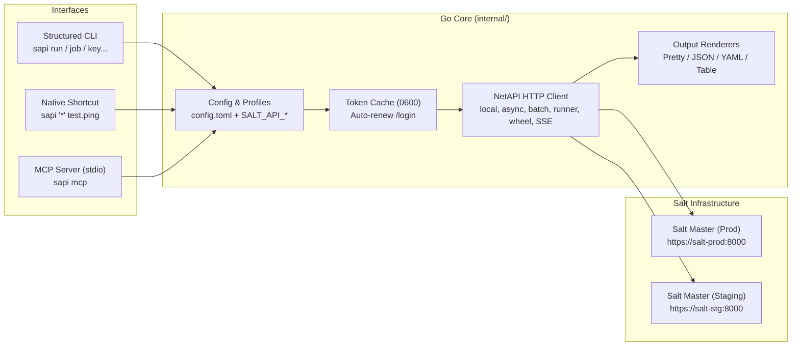

# `sapi` — SaltStack `salt-api` CLI & Full-Access MCP Server

[](https://github.com/laurentL/salt-api-cli/actions/workflows/ci.yml)
[](https://goreportcard.com/report/github.com/laurentL/salt-api-cli)
[](LICENSE)

**`sapi`** is a fast, zero-dependency Go command-line client that wraps **SaltStack's `salt-api` (`netapi`: `rest_cherrypy` / `rest_tornado`)** and embeds a **Full-Access Model Context Protocol (MCP) server (`stdio`)** for AI coding and operations agents (Claude Code, Gemini CLI, Cursor, Google Antigravity).

---

## Key Features

- **Hybrid CLI Experience**:
  - **Drop-in `salt` Shortcut Mode**: Run `sapi '*' test.ping`, `sapi -G 'os:Debian' cmd.run 'uptime'`, or `sapi -b 25% '*' state.highstate` directly without verbose subcommands.
  - **Structured Subcommands**: `run`, `async`, `batch`, `job`, `minion`, `runner`, `wheel`, `key`, `event`, `profile`, `auth`, `stats`, and `mcp`.
- **Multi-Profile & Flexible Secret Resolution**:
  - Manage multiple Salt Masters (`prod`, `staging`, `dev`) in `~/.config/sapi/config.toml`.
  - Resolve credentials via `password_env`, `password_cmd` (e.g., `pass`, `secret-tool`, `1password`), environment variables (`SALT_API_*`), or interactive terminal prompt.
- **Automatic Token Caching & Renewal**:
  - Caches `X-Auth-Token` in `~/.cache/sapi/tokens.json` with strict `0600` permissions.
  - Proactively refreshes tokens before expiration and transparently retries once on `HTTP 401 Unauthorized`.
- **Rich Output Renderers**:
  - `pretty` (colorized tree output matching native Salt CLI + automatic `state.apply` / `highstate` summary table), `json`, `yaml`, and `table`.
- **Built-in Full-Access MCP Server (`sapi mcp`)**:
  - Exposes **12 MCP tools** over `stdio` allowing AI agents to inspect minions/grains/jobs, run execution modules, apply states, execute Master runners/wheel functions, manage minion keys (`list`, `accept`, `reject`, `delete`, `finger`), and trigger Salt webhooks across any configured profile.

---

## Architecture



---

## Installation

### Via `go install`
```bash
go install github.com/laurentL/salt-api-cli/cmd/sapi@latest
```

### Debian / Ubuntu Package (`.deb`)
Build and install the native `.deb` package (includes `/usr/bin/sapi`, `man` pages `sapi(1)` + `sapi-*(1)`, and `bash`/`zsh`/`fish` completions):
```bash
make deb
sudo dpkg -i dist/sapi_1.0.0-1_amd64.deb

# Or using standard debhelper:
dpkg-buildpackage -us -uc -b
```

### From Source (`Makefile`)
```bash
git clone https://github.com/laurentL/salt-api-cli.git
cd salt-api-cli
make all
make install
# Installs binary to ~/bin/sapi and man pages to ~/.local/share/man/man1/
```

### Man Pages
```bash
man sapi
man sapi-run
man sapi-key
man sapi-mcp
```

---

## Configuration (`~/.config/sapi/config.toml`)

Initialize a sample configuration file:
```bash
sapi profile init
```

Or create/update a profile directly from the CLI:
```bash
sapi profile set prod \
  --url https://salt-master.prod.example.com:8000 \
  --user saltadmin \
  --eauth pam \
  --password-env SALT_PROD_PASSWORD \
  --default
```

Example `~/.config/sapi/config.toml` (see [config.example.toml](config.example.toml)):
```toml
default_profile = "prod"
default_output = "pretty" # pretty | json | yaml | table

[profiles.prod]
url = "https://salt-master.prod.example.com:8000"
username = "saltadmin"
password_env = "SALT_PROD_PASSWORD" # or password_cmd = "secret-tool lookup service salt-prod"
eauth = "pam"                       # pam | ldap | file | sharedsecret | auto
verify_ssl = true
timeout = "60s"

[profiles.staging]
url = "https://salt-master.staging.example.com:8000"
username = "saltadmin"
password_env = "SALT_STAGING_PASSWORD"
eauth = "pam"
verify_ssl = false
timeout = "30s"
```

### Environment Variable Overrides
CLI flags take precedence over environment variables, which take precedence over `config.toml`:
- `SALT_API_PROFILE`: Active profile name
- `SALT_API_URL`: Salt Master `salt-api` URL
- `SALT_API_USER`: Username
- `SALT_API_PASSWORD`: Password
- `SALT_API_EAUTH`: External auth backend (`pam`, `ldap`, `file`, `sharedsecret`)
- `SALT_API_TOKEN`: Pre-existing `X-Auth-Token`
- `SALT_API_INSECURE`: Skip TLS verification (`true` / `1`)

---

## CLI Usage

### 1. Native `salt` Shortcut Mode
Any command whose first positional argument is not a reserved subcommand is automatically executed against targeted minions:
```bash
# Connectivity check
sapi '*' test.ping

# Target by Grain (-G), PCRE (-E), List (-L), Pillar (-I), Compound (-C), Nodegroup (-N), Subnet (-S)
sapi -G 'os_family:Debian' pkg.install htop refresh=True
sapi -L 'web-01,web-02' service.restart nginx
sapi -C 'G@os:Ubuntu and E@db-.*' cmd.run 'df -h'

# Asynchronous execution with live job polling
sapi --async --wait '*' state.apply common test=True

# Progressive batch execution
sapi -b 20% '*' state.highstate
```

### 2. Structured Subcommands
```bash
# Authentication & token cache inspection
sapi auth login -p prod
sapi auth status
sapi auth logout

# Jobs management
sapi job list --limit 15 --function state.apply
sapi job get 20261015130000123456 --info
sapi job wait 20261015130000123456 --interval 2s --timeout 5m
sapi job active

# Minions & Grains inventory
sapi minion list
sapi minion grains web-01 os ipv4 mem_total
sapi minion status

# Master Runners & Wheel modules
sapi runner manage.up
sapi runner state.orchestrate orch.deploy pillar='{"version":"2.1.0"}'
sapi wheel config.values

# Minion Keys management (via Wheel)
sapi key list
sapi key accept web-new-01
sapi key reject web-unwanted-01
sapi key delete web-old-01
sapi key finger '*'

# Real-time Event Bus (SSE) & Webhooks
sapi event listen --tag 'salt/job/*' --count 10
sapi event hook deploy/app -d '{"env":"staging","version":"1.2.3"}'

# Salt-API server statistics
sapi stats
```

---

## MCP Server Integration (Claude Code / Gemini CLI / Antigravity / Cursor)

`sapi mcp` (or `sapi --mcp`) starts a Model Context Protocol server over `stdio`. Technical logs are written to `/tmp/sapi_mcp.log` so `stdout` remains strictly reserved for JSON-RPC frames.

Add the following entry to your `mcp_config.json` (or `.mcp.json`):
```json
{
  "mcpServers": {
    "salt": {
      "command": "sapi",
      "args": ["mcp"]
    }
  }
}
```

### Exposed MCP Tools (Full Access)
Every tool accepts an optional `profile` parameter so the AI agent can dynamically target `prod`, `staging`, or `dev`:

| Tool Name | Description |
| :--- | :--- |
| `salt_list_profiles` | List configured Salt Master profiles from `~/.config/sapi/config.toml` and show the default profile. |
| `salt_ping` | Test connectivity (`test.ping`) against targeted minions (`tgt`, `tgt_type`). |
| `salt_run` | Execute any Salt execution module (`local`, `local_async` with optional `wait`, or `local_batch`). |
| `salt_state_apply` | Apply a Salt state or `highstate` (`state`, `test`, `pillar`, `saltenv`, `wait`). |
| `salt_list_minions` | List known minions and their grains or online/offline status (`manage.status`). |
| `salt_get_minion_grains` | Fetch full or filtered grains for a specific minion (`minion_id`, `grain`). |
| `salt_list_jobs` | List historical jobs (`/jobs`) or currently running jobs (`active_only=true`). |
| `salt_get_job` | Retrieve full return data for a `jid` (with optional `wait=true` polling). |
| `salt_runner` | Execute any Salt Master Runner module (`fun`, `args`, `kwargs`, `async`). |
| `salt_wheel` | Execute any Salt Master Wheel function (`fun`, `args`, `kwargs`, `async`). |
| `salt_keys_manage` | Manage minion keys (`list`, `accept`, `reject`, `delete`, `finger`). |
| `salt_send_hook` | Trigger a Salt-API webhook (`POST /hook/<tag>`) with a JSON payload. |

---

## License

Released under the [MIT License](LICENSE).
